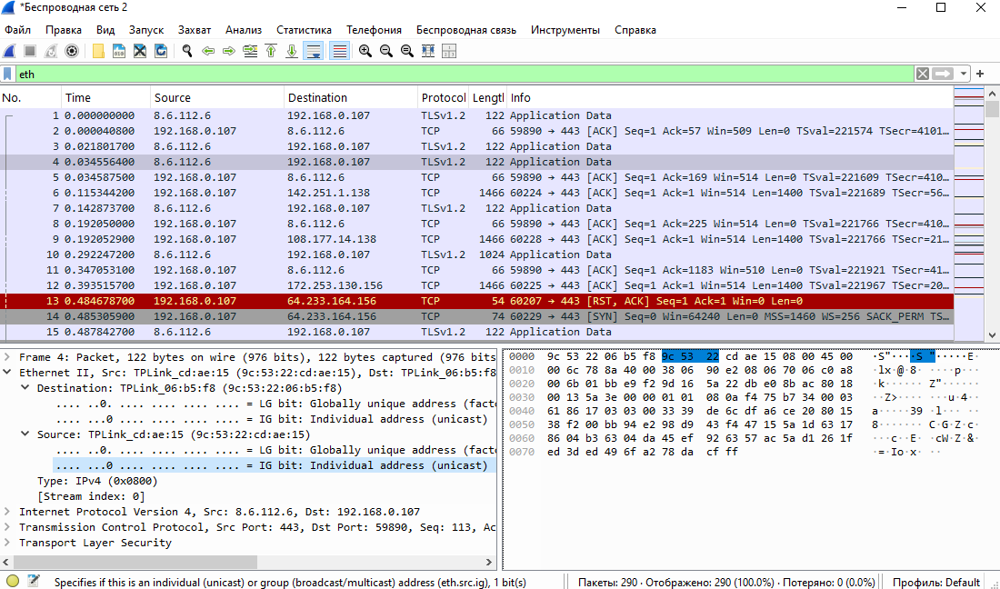

# ДОМАШНЕЕ ЗАДАНИЕ
## ПО ДИСЦИПЛИНЕ «КОМПЬЮТЕРНЫЕ СЕТИ»
### **Тема: «Коммутация Ethernet»** 

| | |
| :--- | :--- |
| Студент: | Станчинская Соня |
| Группа: | 9/2-РПО-25/3 (РПО9-3) |

Скришот Wireshark