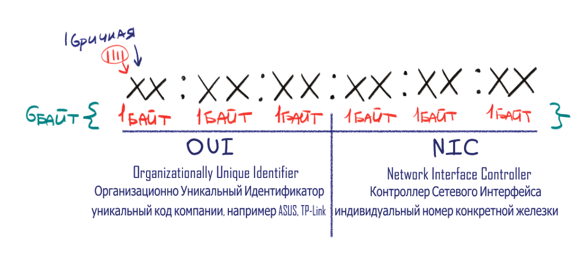
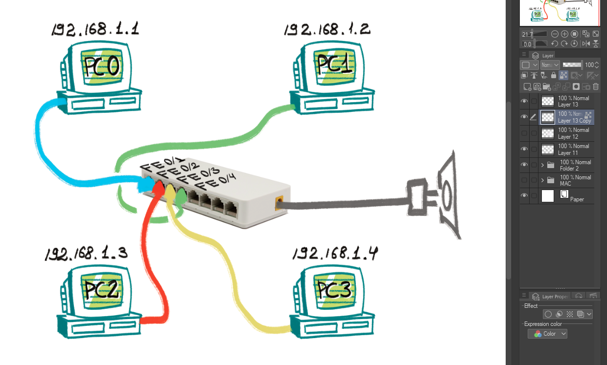
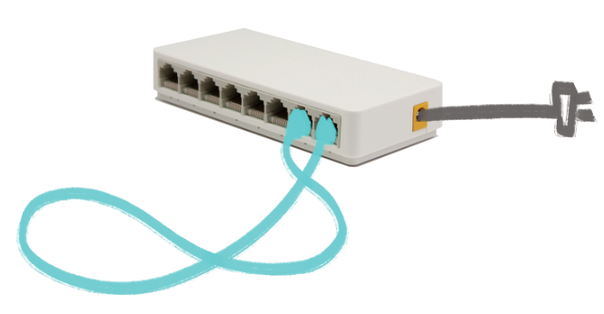
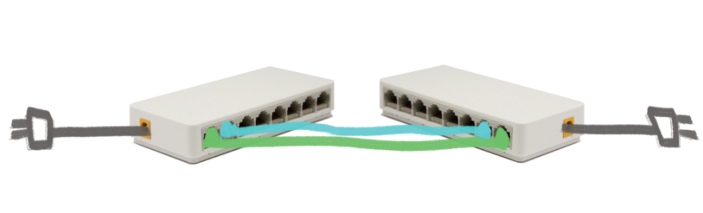

# ДОМАШНЕЕ ЗАДАНИЕ
## ПО ДИСЦИПЛИНЕ «КОМПЬЮТЕРНЫЕ СЕТИ»
### **Тема: «Сети»** 

| | |
| :--- | :--- |
| Студент: | Станчинская Соня |
| Группа: | 9/2-РПО-25/3 (РПО9-3) |

Схема MAC-адреса

Схема сооединения компьютеров с коммутатором

## Возможные ошибки и как их исправить

### Конфликт IP-адресов
- Возникает когда двум устройствам назначают одинаковый IP-адрес
- Исправляется изменением IP-адреса одного из хостов на уникальный свободный из текущей подсети.

### Несовпадение логических подсетей
- Возникает когда устройства подключенны к одному коммутатору, но находятся в разных логических подсетях (сетевая часть IP-адреса не совпадает).
- Исправляется назначением одинаковой сетевой части IP-адреса каждому из хостов.

### Коммутационная петля
- Возникает при соединении портов одного коммутатора между собой, или при создании "кольца" между двумя коммутаторами (если нет для этого программной защиты, чтобы второй кабель оставался запасным).
Широковещатель будет ходить покругу.
- Исправляется отключением провода, для двух коммутаторов можно настроить протокол STP, чтобы коммутатор понял что это запасной провод.

