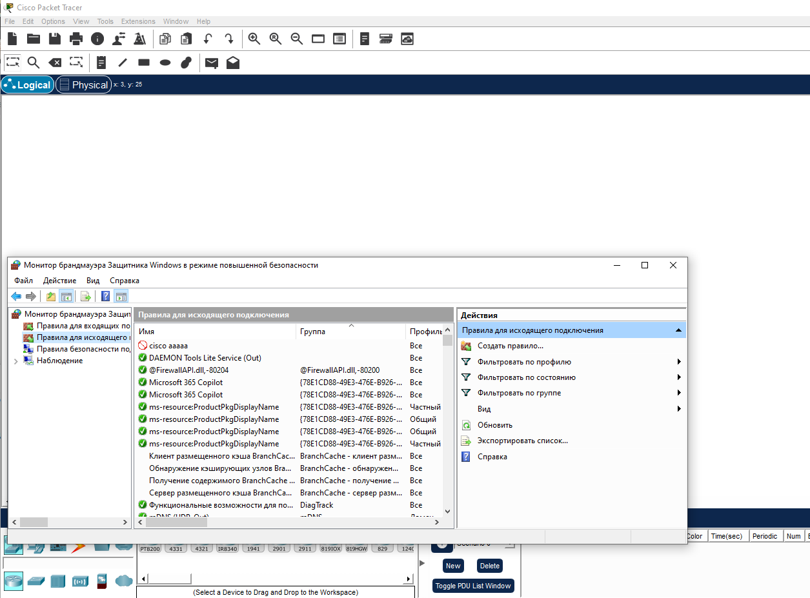
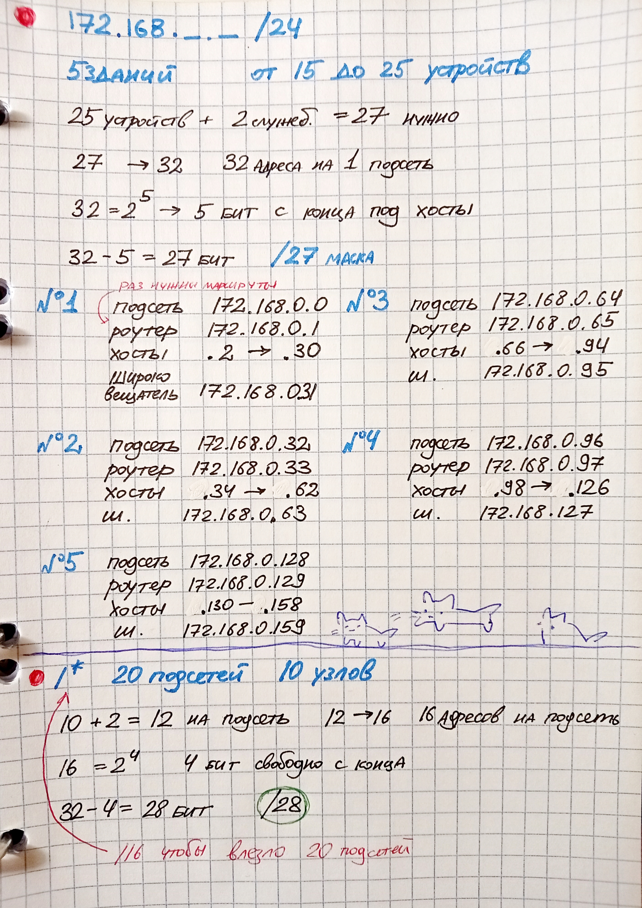

# ДОМАШНЕЕ ЗАДАНИЕ
## ПО ДИСЦИПЛИНЕ «КОМПЬЮТЕРНЫЕ СЕТИ»
### **Тема: «IPv4»** 

| | |
| :--- | :--- |
| Студент: | Станчинская Соня |
| Группа: | 9/2-РПО-25/3 (РПО9-3) |

### №1

Скриншот открытого cisco

### №2-3

>Вам потребуется распределить 172.168 /24 IP адрес на подсети где 5 зданий с маршрутами и в каждом от 15 до 25 устройств.

>Найдите нужную длину для /* для 20 подсетей и 10 узлов

