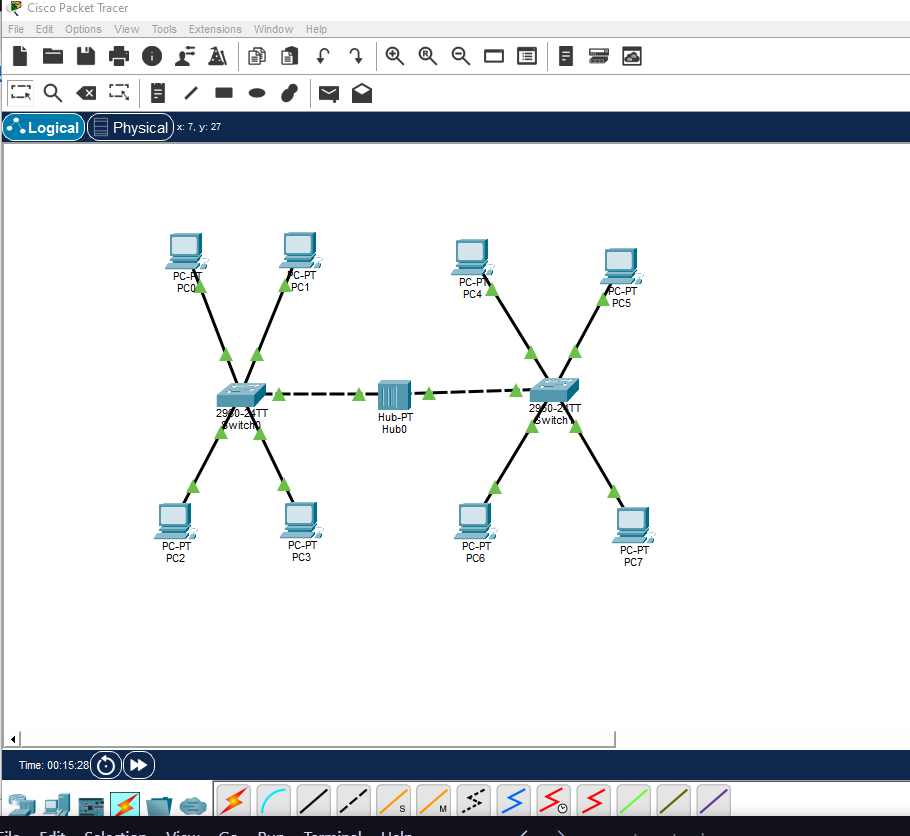
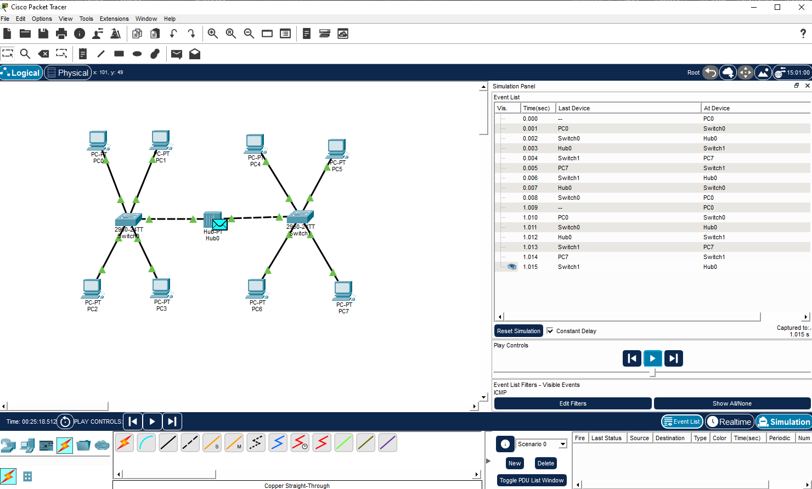
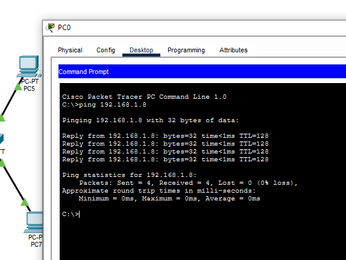

# ДОМАШНЕЕ ЗАДАНИЕ
## ПО ДИСЦИПЛИНЕ «КОМПЬЮТЕРНЫЕ СЕТИ»
### **Тема: «Cisco»** 

| | |
| :--- | :--- |
| Студент: | Станчинская Соня |
| Группа: | 9/2-РПО-25/3 (РПО9-3) |

>Вам потребуется построить сеть в циско с 8 компьютераи 2 комутаторами и 1 хабом

>в дз присылаете ссылку на гитхаб где у вас 3 фото на 1 схема, на втором консольный ping,  на 3 работа симулятора по отправки пинга

### №1 Cхема

### №2 Консольный ping

### №3 Симуляция отправки пинга

