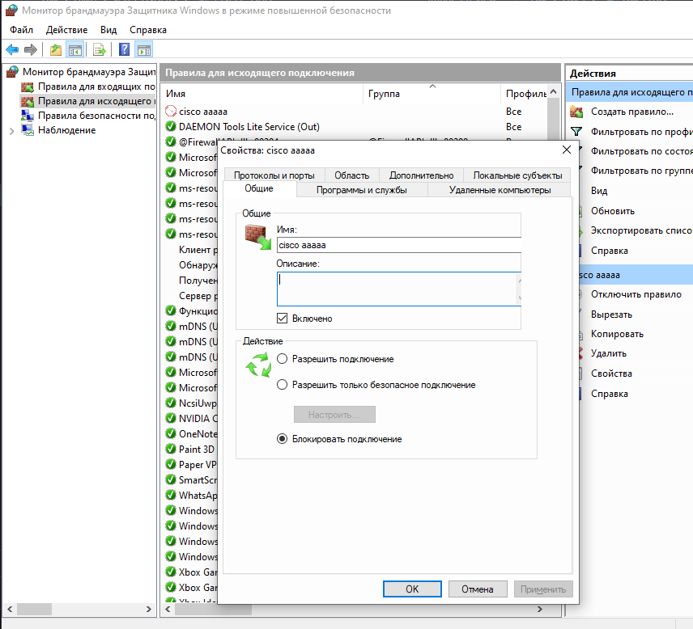
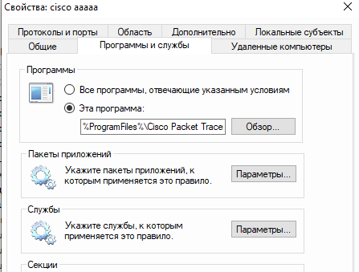

# ДОМАШНЕЕ ЗАДАНИЕ
## ПО ДИСЦИПЛИНЕ «КОМПЬЮТЕРНЫЕ СЕТИ»
### **Тема: «Cisco»** 

| | |
| :--- | :--- |
| Студент: | Станчинская Соня |
| Группа: | 9/2-РПО-25/3 (РПО9-3) |

>Вам нужно скачать циско и сделать блок через брандмаузер

Скришот с блоком cisco через брендмауэр. Работает :)
