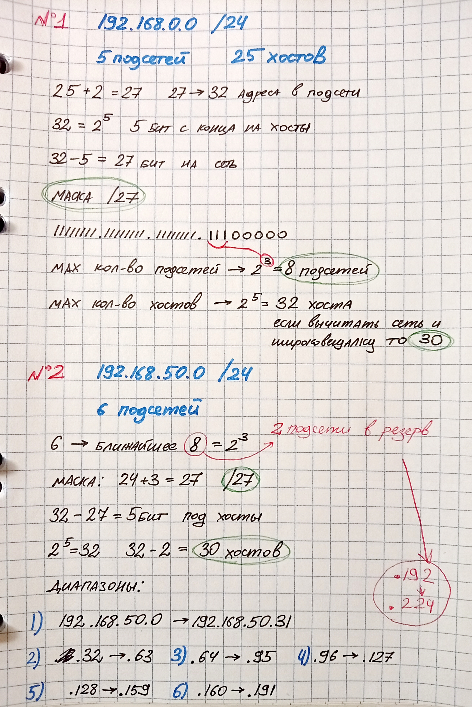

# ДОМАШНЕЕ ЗАДАНИЕ
## ПО ДИСЦИПЛИНЕ «КОМПЬЮТЕРНЫЕ СЕТИ»
### **Тема: «Задачки»** 

| | |
| :--- | :--- |
| Студент: | Станчинская Соня |
| Группа: | 9/2-РПО-25/3 (РПО9-3) |

>Нужно 5 подсетей в каждом не менее 25 Сеть: 192.168.0.0  /24

>192.168.50.0 /24 Разделите на 6 подсетей Какая маска, сколько хостов, и диапазоны подсетей

