

# ДОМАШНЕЕ ЗАДАНИЕ
## ПО ДИСЦИПЛИНЕ «КОМПЬЮТЕРНЫЕ СЕТИ»
### **Тема: «Cisco, NAT»** 

| | |
| :--- | :--- |
| Студент: | Станчинская Соня |
| Группа: | 9/2-РПО-25/3 (РПО9-3) |

### №1 Создание VLAN2 и VLAN3

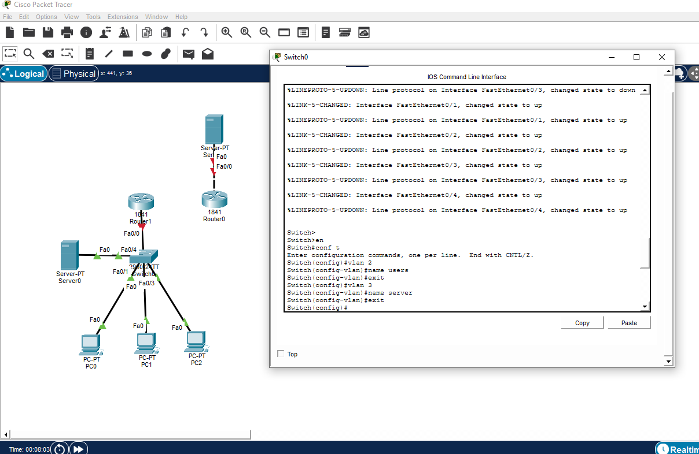

### №2 Настройка портов ПК во VLAN 2 , сервера во VLAN 3 и маршрутизатора

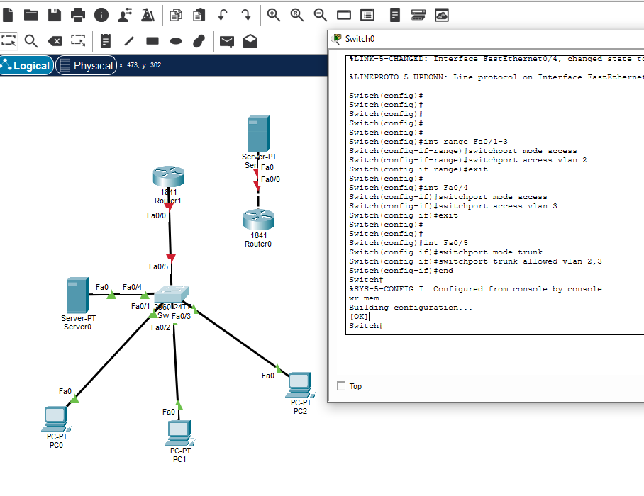

### №3 Проверка конфигурации командой show run

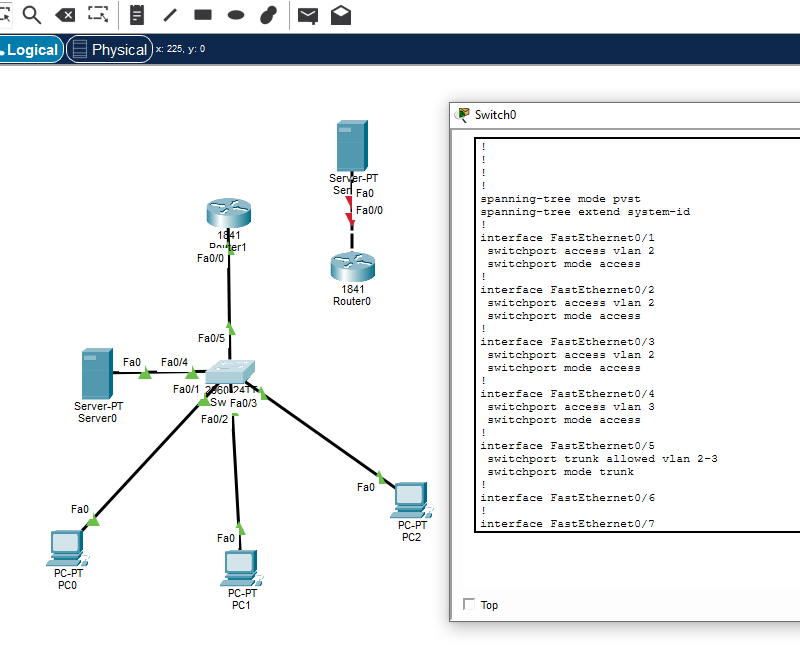

### №4 Настройка маршрутизатора

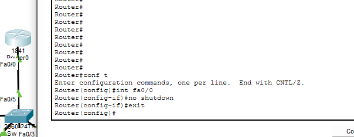

### №5 Создание sub-интерфейсов для VLAN2 и VLAN3

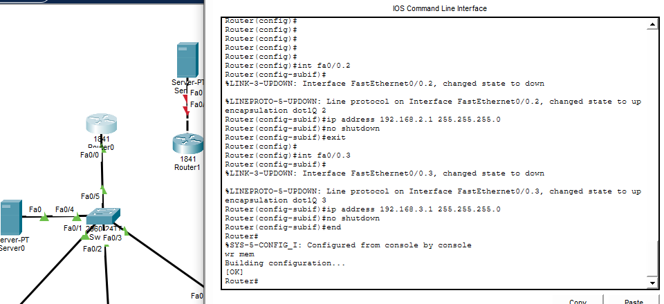

### №6 Проверка конфигурации командой show run

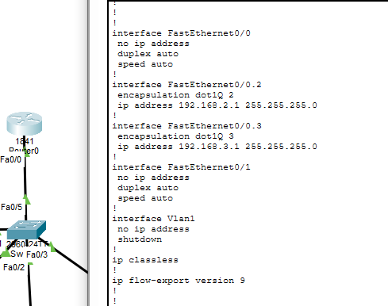

### №7 Настройка ip-адресов, масок и шлюзов PC0, PC1, PC2

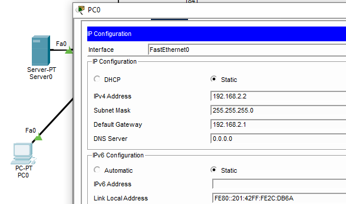
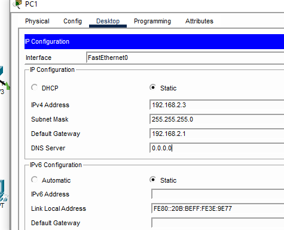
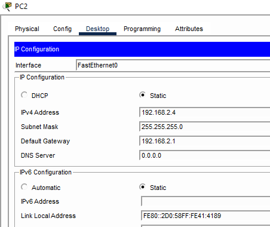

### №8 Настройка ip-адреса, маски и шлюза сервера

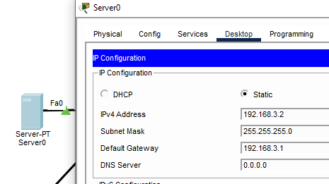

### №9 Проверка связи  PC0 со шлюзом, PC1, PC2 и сервером

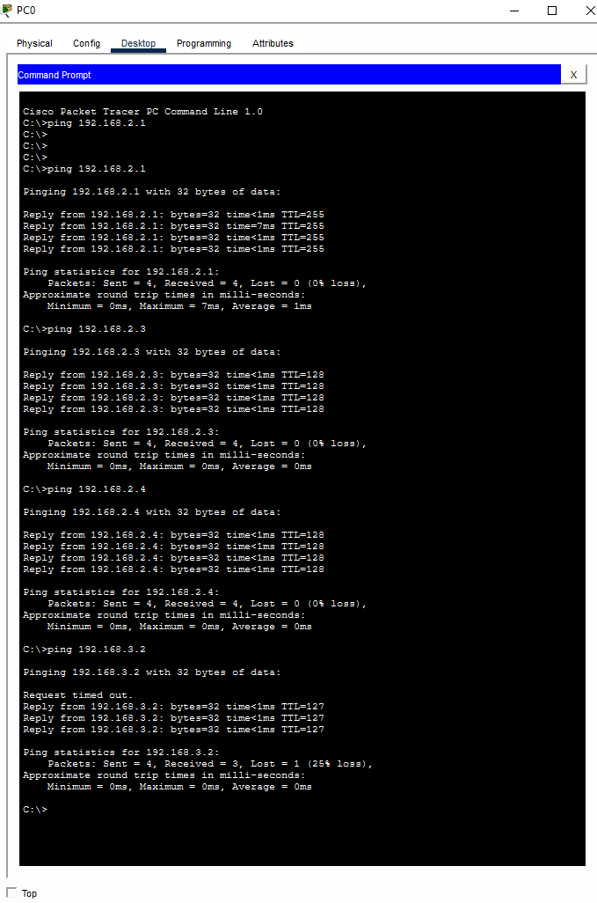
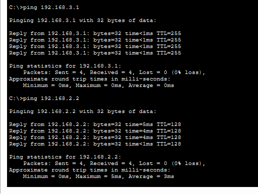

### №10 Настройка интерфейсов на маршрутизаторе провайдера

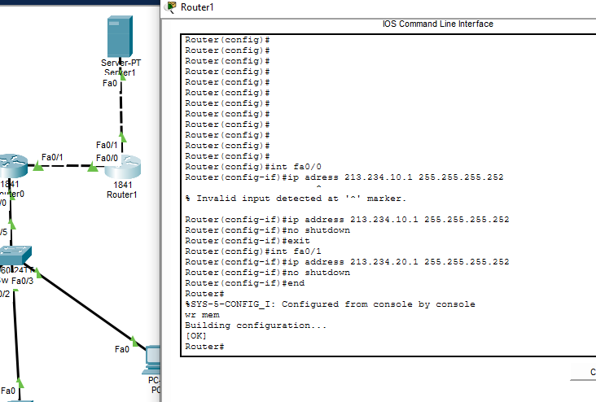

### №11 Настройка ip-адреса, маски и шлюза сервера провайдера

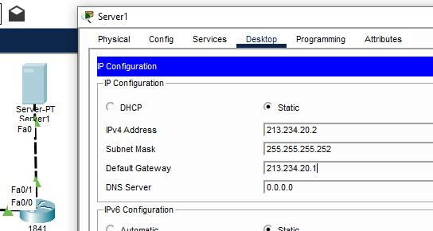

### №12 Проверка конфигурации командой show run

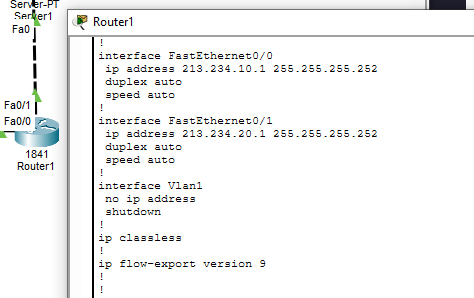

### №13 Настройка маршрута по умолчанию к провайдеру

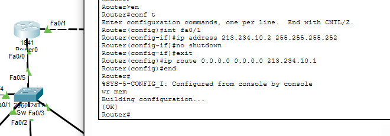

### №14 Проверка связи с провайдером
 

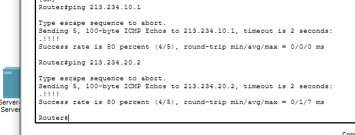

### №15 Проверка связи PC0 с сервером провайдера (до NAT)

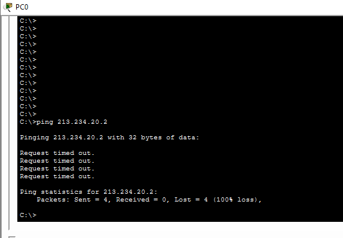

### №16 Настройка интерфейсов NAT (Inside/Outside)

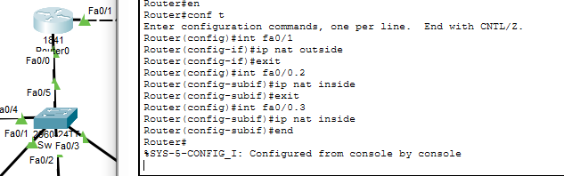

### №17 Настройка именованного access-листа FOR-NAT

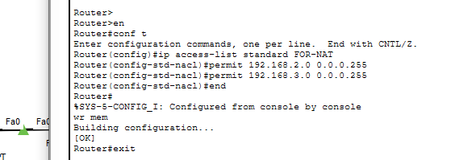

### №18 Проверка конфигурации командой show run

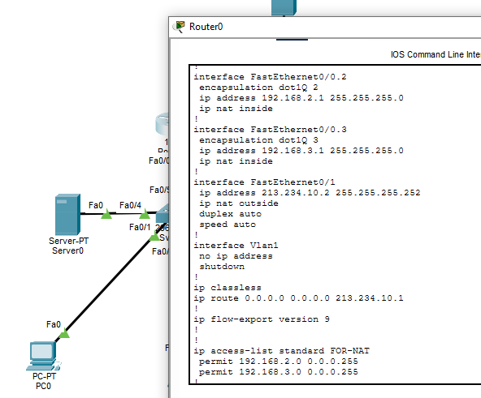

### №19 Настройка PAT

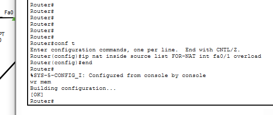

---

## Проверки

### №20 Проверка связи  PC0 с сервером провайдера 

теперь работает юхуу

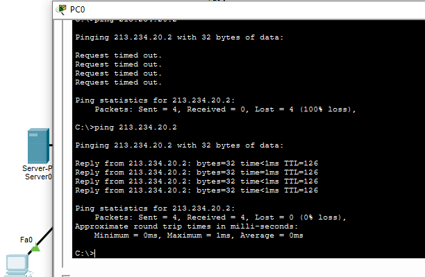

### №21 Просмотр таблицы трансляций NAT

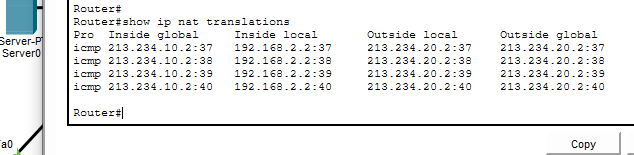

### №22 Проверка связи локального сервера с сервером провайдера

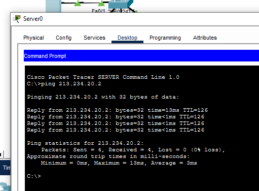

### №23 Просмотр таблицы трансляций NAT

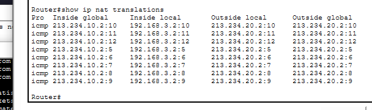

### №24 Письмо PC0 -> Сервер провайдера

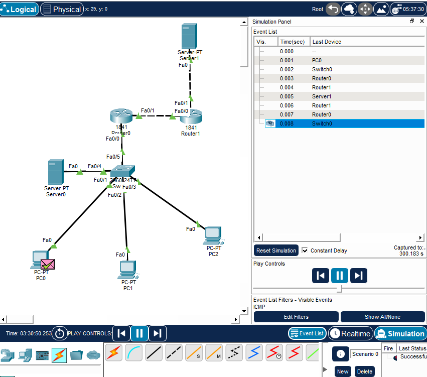

### №25 Редактирование страницы веб-сервера Server0

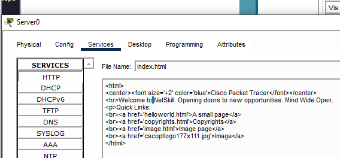

### №26 Проверка доступности веб-сервера

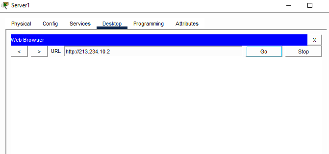

### №27 Настройка статического NAT

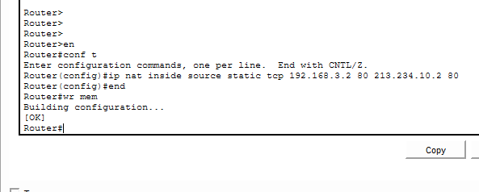

### №28 успешное открытие сайта локального сервера

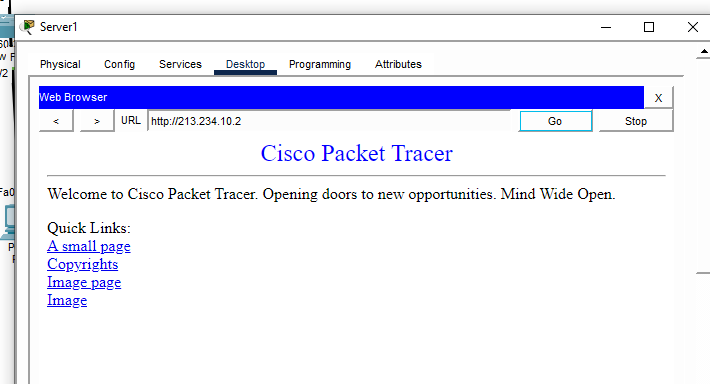

