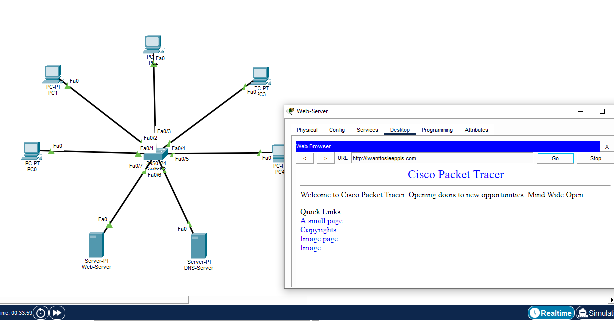

# ДОМАШНЕЕ ЗАДАНИЕ
## ПО ДИСЦИПЛИНЕ «КОМПЬЮТЕРНЫЕ СЕТИ»
### **Тема: «Cisco, DNS»** 

| | |
| :--- | :--- |
| Студент: | Станчинская Соня |
| Группа: | 9/2-РПО-25/3 (РПО9-3) |

>Построить DNS сервер с 5 компами и 1 сервером сайтом, пришлите в гит файл и скрин

### Скриншот

[Файлик Cisco :3](hw12_DNS.pkt)

