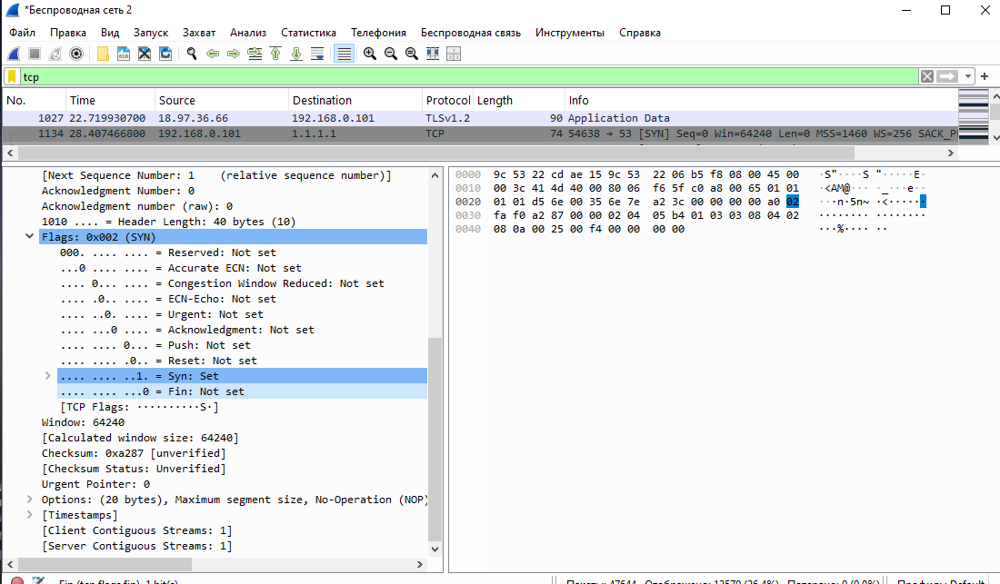
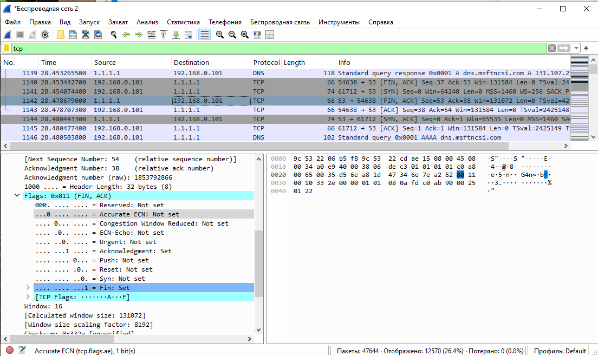
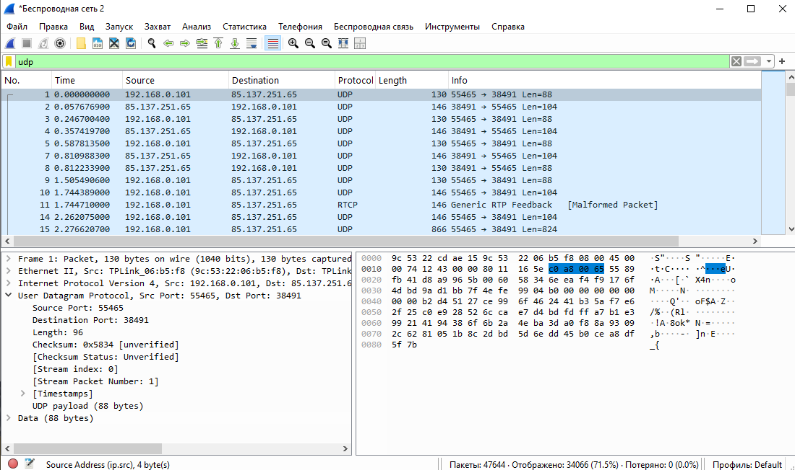

# ДОМАШНЕЕ ЗАДАНИЕ
## ПО ДИСЦИПЛИНЕ «КОМПЬЮТЕРНЫЕ СЕТИ»
### **Тема: «Wireshark, TCP UDP»** 

| | |
| :--- | :--- |
| Студент: | Станчинская Соня |
| Группа: | 9/2-РПО-25/3 (РПО9-3) |

>Вам потребуется прислать 3 скриншот из wireshark где на 2-х tcp с разными флагами, а на 3 udp

### TCP

№1 SYN

№2 FIN, ACK

### UDP

