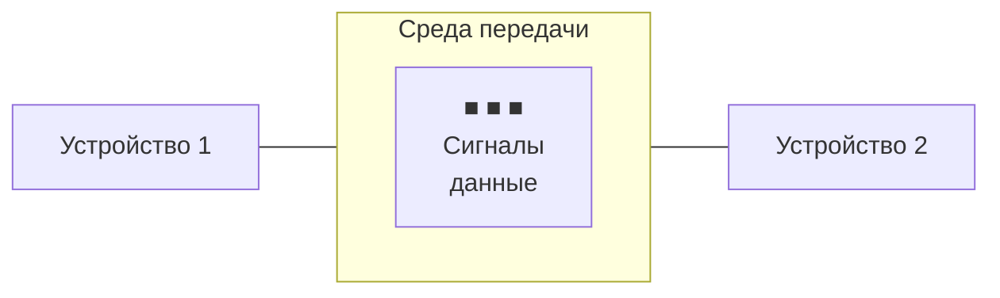
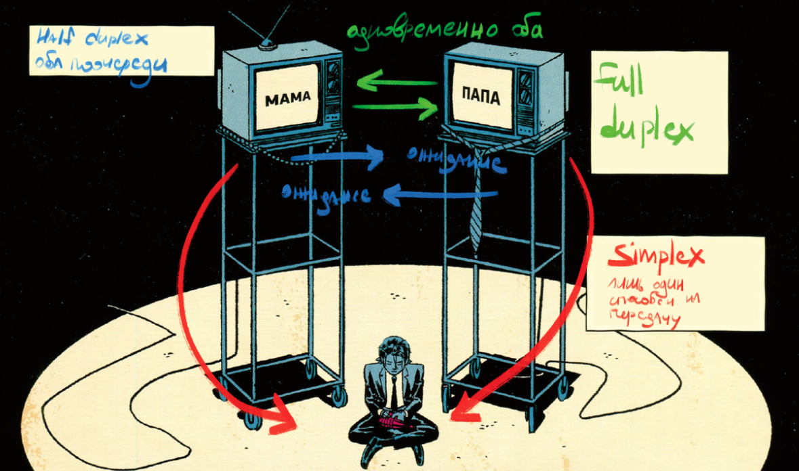
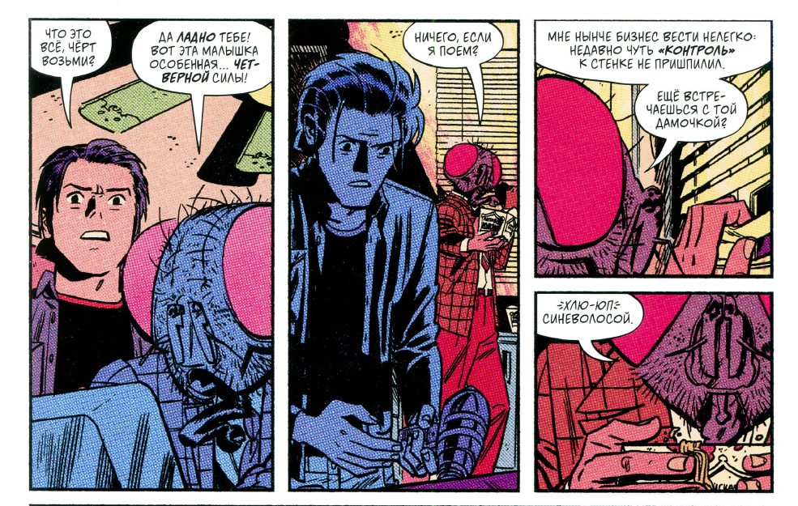
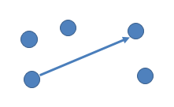
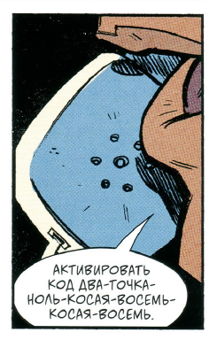
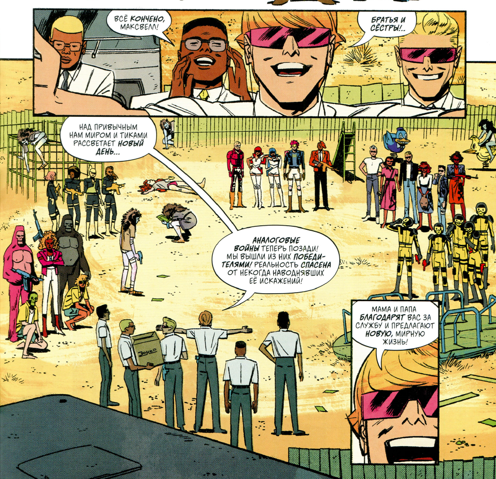
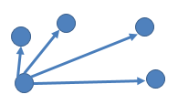
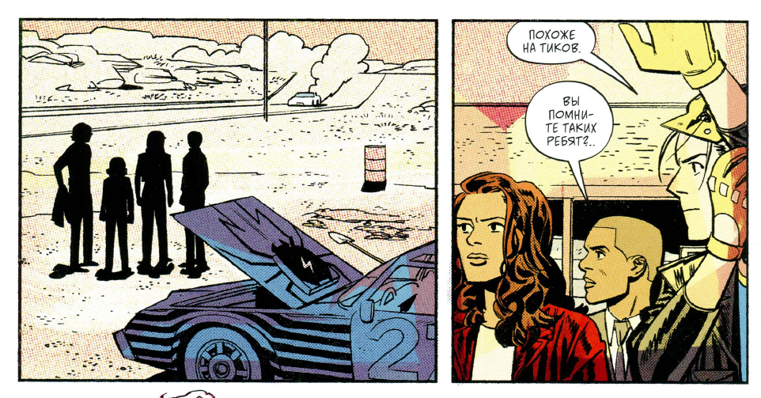
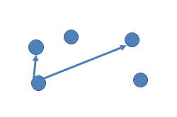
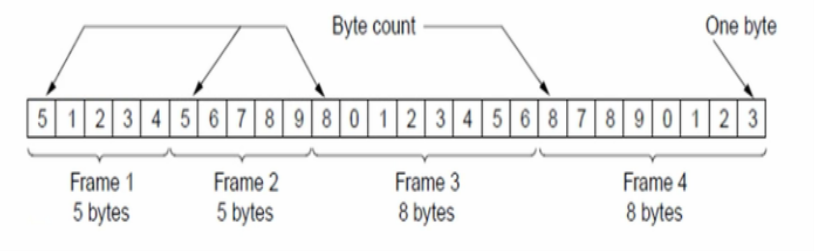

## Передача данных

>Слово duplex происходит от латинского duplex, что означает «двойной» (от duo — два, и plex — сплетение, складка). Слово simplex означает «простой» (одинарный).

|||
|:---|:---|
|simplex| лишь один передает, второй слушает (GPS)|
|half - duplex| оба поочереди (радио)|
|full - duplex| оба одновременно (телефон)|

>Сast - значение «распространять сигнал». Вы сталкиваетесь с этим каждый день: Pod-cast (Подкаст)

|||
|:---|:---|
|`Unicast` – передача данных единственному адресату|Unicast (Одноадресная передача)	Uni (от лат. unus — один) + Cast (вещание)	«Вещание для одного»|
|`Broadcast` – широковещательная передача данных всем адресатам |Broadcast (Широковещание)	Broad (англ. широкий, просторный) + Cast (вещание)	«Широкое вещание»|
|`Multicast` – передача данных конкретно группе адресатов |Multicast (Многоадресная передача)	Multi (от лат. multus — много) + Cast (вещание)	«Вещание для многих»|

## unicast

сцены с шопотом на ухо нет так что это, а нет , нашла

## broadcast

одииин всем при всем

## multicast

конкретной группе

---
## ВИДЫ СЕТЕЙ

|||
|:---|:---|
|`PAN` (Personal Area Network)| персональная сеть, например bluetooth наушники и пк. около 1 метра|
|`LAN` (Local area network)| локальная сеть, объединяет небольшое количество устройств на ограниченной территории (до  нескольких сотен метров).|
|`MAN` (Metropolitan Area Network)| – городская сеть, объединяет большое количество устройств в пределах города (обычно до 50 км).|
|`WAN` (Wide Area Network)| – глобальная сеть, объединяет большое кол-во устройств по всему миру.|
|`Internetwork` (Internet)| «Объединение сетей» или «Межсетевое взаимодействие». обьединение всего предыдущего за счет маршрутизаторов|

протокол - одинаковый язык у одинаковых уровней (директор отсылает письмо на русском, другой директор понимает так как тоже общается на русском)

интерфейс команд - набор команд услуг нижнего уровня "секретарю" для "директора". отправить письмо, принести кофе и тд. способ общения директора и секретаря

сервис - что делает уровень ? 
-кто такой секретарь че он делает вообще
-он умеет приносить и относить письма
-аааа...

служебная информация - пометки секретаря для другого секретаря чтобы обоим не дали по шапке и принести данные правильно (стирают чтобы директор не заподозрил)

---

• Процесс спуска и наклеивания конвертов (Кадры 1-3) называется Инкапсуляция.
• Процесс подъема и срывания конвертов (Кадры 4-6) называется Декапсуляция (это как раз то, что вы записали в строке 78 вашего конспекта: «стирают, чтобы директор не заподозрил»).

7) прикладной - затащить песню мышкой в чат telegram
6) представление - перевел mp3 в биты и зашифровал
5) сеансовый - Сеансовый уровень проверяет: «Так, Telegram сейчас подключен к серверу? Да, сессия открыта. Ток идет, авторизация пройдена, мы готовы отправлять». Если посреди отправки песни Wi-Fi на секунду моргнет, именно 5-й уровень сделает так, чтобы передача не сбросилась в ноль, а продолжилась с того же места (контрольная точка).
4) транспортный - берет файл из битов и делит на мелкие кусочки
3) сетевой - подписывается ip сервера и ip компа для каждого кусочка (пакетики)
2) канальный - упаковывает пакеты в кадры (локальная обертка чтобы поняло железо) + mac адрес к какому железу
1) физический - 010101010101010110

📉 Первая половина: От вас в провод (Упаковка / Инкапсуляция)
• Этап 1 (Уровень 7 — Прикладной): Вы перетащили песню в Telegram.
• Этап 2 (Уровень 6 — Представления): Telegram перевел её в байты и зашифровал.
• Этап 3 (Уровень 5 — Сеансовый): Проверил, что сессия с сервером активна и держит связь.
• Этап 4 (Уровень 4 — Транспортный): Нарезал большой файл на кусочки и пронумеровал их (Сегменты).
• Этап 5 (Уровень 3 — Сетевой): Наклеил на каждый кусочек IP-адреса (Пакеты).
• Этап 6 (Уровень 2 — Канальный): Завернул пакеты в локальные рамки с MAC-адресом роутера (Кадры).
• Этап 7 (Уровень 1 — Физический): Превратил всё в импульсы и вытолкнул в кабель (Биты).

🚀 ЭТАП ПЕРЕХОДА (Точка ноль): Ток бежит по проводам интернета от вас к другу.

📈 Вторая половина: Из провода к другу (Распаковка / Декапсуляция)
А теперь компьютер друга принимает этот поток и начинает сдирать наслойки строго снизу вверх, возвращаясь к чистой музыке:
• Этап 8 (Уровень 1 — Физический): Сетевая карта друга ловит из провода голые Биты (01010101).
• Этап 9 (Уровень 2 — Канальный): Нарезает этот поток битов на четкие Кадры, проверяет MAC-адрес (убеждается, что прилетело именно ему) и срывает локальную обертку кадров.
• Этап 10 (Уровень 3 — Сетевой): Достает очищенные Пакеты. Смотрит на IP-адрес: «Да, это пакеты для моего IP». Срывает конверты с IP-адресами.
• Этап 11 (Уровень 4 — Транспортный): Принимает Сегменты. Протокол TCP смотрит на их номера, раскладывает по порядку (1, 2, 3...) и склеивает обратно в один сплошной зашифрованный поток данных. Если какого-то куска не хватает, именно на этом этапе компьютер друга крикнет вашему компьютеру: «Эй, потерялся кусок №5, пришли еще раз!».
• Этап 12 (Уровень 5 — Сеансовый): Фиксирует: «Прием данных по этой сессии окончен, закрываем сеанс передачи файла».
• Этап 13 (Уровень 6 — Представления): Расшифровывает этот поток байтов обратно в нормальный файл и понимает по расширению .mp3, что это музыка, которую нужно передать плееру.
• Этап 14 (Уровень 7 — Прикладной): Чистое Сообщение (готовый файл песни) всплывает в чате Telegram у вашего друга. Он видит название трека, нажимает на него мышкой и слушает музыку.

[Твой ПК] 7 ➡️ 6 ➡️ 5 ➡️ 4 ➡️ 3 ➡️ 2 ➡️ 1
                                       │
                     ┌─────────────────┘
                     ▼
[Роутер 1]          1 ➡️ 2 ➡️ 3 ➡️ 2 ➡️ 1
                                       │
                     ┌─────────────────┘
                     ▼
[Роутер 2]          1 ➡️ 2 ➡️ 3 ➡️ 2 ➡️ 1
                                       │
                     ┌─────────────────┘
                     ▼
[Роутер 3]          1 ➡️ 2 ➡️ 3 ➡️ 2 ➡️ 1
                                       │
                     ┌─────────────────┘
                     ▼
[ПК Друга]          1 ➡️ 2 ➡️ 3 ➡️ 4 ➡️ 5 ➡️ 6 ➡️ 7

PDU (Protocol Data Unit) переводится как «Протокольный блок данных».
Это универсальное, строгое научное слово, которым ИТ-инженеры называют любую порцию информации, которая летит по сети

: надежный (TCP) и быстрый (UDP)

• 📦 Сегмент (Segment) — это кусок в протоколе TCP.
Это жесткий, контролируемый кусок данных. Компьютер отправляет его и ждет ответа: «Ты получил сегмент №1? Да? Отлично, шлю сегмент №2». Если ответ не пришел, компьютер отправит сегмент заново. Это как заказное письмо с уведомлением о вручении.
• 🚀 Дейтаграмма (Datagram) — это кусок в протоколе UDP.
Это кусок, который компьютер выбрасывает в сеть по принципу «выстрелил и забыл». Ему абсолютно плевать, долетит он до получателя или потеряется по дороге, он не ждет никаких подтверждений и просто фигачит поток дальше.

📉 Первая половина: Спуск вниз (Вы отправляете песню)
• Уровень 4: Прикладной (Application)
	• Что делает: Здесь живет сама программа — Telegram. Вы закинули песню и нажали «Отправить». Telegram переводит песню в поток байтов и шифрует его.
	• Единица данных: Сообщение (PDU) — целая, готовая к отправке песня.
	• Ваша логика: Вы (Директор) написали текст приказа.
• Уровень 3: Транспортный (Transport)
	• Что делает: Тот самый контролер (протоколы TCP или UDP). Он берет этот огромный поток байтов песни и режет его на мелкие кусочки, чтобы они пролезли в сеть.
	• Единица данных: Сегмент (в TCP) или Дейтаграмма (в UDP).
	• Ваша развилка: Кусочки строго нумеруются: 1 из 50, 2 из 50... (чтобы потом проверить, всё ли дошло).
• Уровень 2: Межсетевой / Сетевой (Internet)
	• Что делает: Уровень-навигатор. Он берет каждый кусочек песни и упаковывает его в глобальный конверт с IP-адресами.
	• Единица данных: Пакет (Packet).
	• Что написано на конверте: От кого: IP вашего ПК -> Кому: IP сервера Telegram. Эти адреса не изменятся до самого конца пути.
• Уровень 1: Сетевых интерфейсов / Уровень доступа к среде (Network Interface)
	• Что делает: Это чернорабочий уровень. Он объединяет сетевую карту, Wi-Fi и провода. Он берет готовый пакет с IP-адресом, заворачивает его в локальную рамку (Кадр) с MAC-адресом домашнего роутера и превращает в электрические импульсы.
	• Единица данных: Кадр (Frame) inside сетевой карты ➡️ Биты (Bits) внутри провода (010101).
🚀 ПЕТЛЯ В ПУТИ (Те самые прыжки через роутеры)
Пока пакет летит через страну, он много раз прыгает по циклу: Уровень 1 ➡️ Уровень 2 ➡️ Уровень 1.
Роутер в пути ловит биты, собирает в кадр, сдирает его, заглядывает на Уровень 2 (в IP-адрес): «Ага, не мое, передать дальше». Заворачивает в новый кадр и пуляет биты в следующий провод.
📈 Вторая половина: Подъем наверх (Компьютер друга принимает песню)
Пакет прилетел к другу, и его операционная система начинает сдирать наслойки конвертов снизу вверх:
• Уровень 1: Сетевых интерфейсов
	• Сетевая карта друга ловит из провода голые Биты (010101), собирает их в Кадр, проверяет локальный MAC-адрес: «Прилетело четко в мою железку». Срывает локальную рамку кадра и передает «чистый конверт» наверх.
• Уровень 2: Межсетевой (Internet)
	• Принимает Пакет. Смотрит на IP-адрес: «О, это МОЙ IP-адрес! Долетело!». Срывает этот конверт с IP-адресами и передает очищенные кусочки данных выше.
• Уровень 3: Транспортный (Transport)
	• Принимает Сегменты. И вот тут срабатывает ваша гениальная фраза: «Все сегменты дошли? О, отлично!». Контролер TCP сверяет номера кусков, раскладывает их по порядку и склеивает обратно в один сплошной файл.
• Уровень 4: Прикладной (Application)
	• Получает чистое Сообщение — готовый, целый файл Musical Interlude Pt. 3.mp3. Telegram друга выводит песню на экран, друг нажимает Play и слушает музыку.

1. Физический уровень ➡️ Концентратор (или Хаб / Hub)
• Логика железки: Когда в один из его портов прилетает сигнал (биты 010101), он не думает, кому это отправлено. Он просто тупо копирует этот ток и фигачит его во ВСЕ остальные дырки (порты) подряд.

>Broadcast

2. Канальный уровень ➡️ Коммутатор (или Свитч / Switch) и Точка доступа (Wi-Fi)
Это устройство появилось, чтобы навести порядок после глупых концентраторов. Оно работает на Уровне 2 (Канальном), а значит — умеет читать MAC-адреса и работать с Кадрами.
• Как он работает: Свитч — это умная домашняя или офисная коробка. У него внутри есть таблица, где записано: «В порту №1 воткнут комп с MAC-адресом А, а в порту №2 — комп с MAC-адресом Б».
• Логика железки (Твоя фраза): Он принимает кадр, вскрывает его рамку, смотрит на MAC-адрес получателя и говорит: «Так, это отправлено для MAC-адреса Б. Это порт №2. Передаю строго туда!».
>• Связь с началом лекции: Свитч позволяет компьютерам общаться по протоколу Unicast (строго тет-а-тет). Соседние провода в этот момент «молчат» и не загружаются чужим мусором.

3. Сетевой уровень ➡️ Маршрутизатор (или Роутер / Router)
Это самая умная железка в этой таблице. Она рулит всем глобальным интернетом. Работает на Уровне 3 (Сетевом), а значит — понимает IP-адреса и умеет читать Карту мира.
• Как он работает: Он связывает между собой совершенно разные сети (например, твою домашнюю сеть LAN и глобальный интернет WAN).
• Логика железки (Твоя фраза): Когда в него прилетает пакет, роутер полностью сдирает локальный кадр (Уровень 2), заглядывает внутрь пакета (Уровень 3) и читает IP-адрес. И тут срабатывает твой алгоритм: «Открыл... О, IP-адрес не мой! Но я знаю по карте, что этот IP находится в Москве. Заворачиваю в новый кадр и передаю следующему роутеру в сторону Москвы!».

• Концентратор (Хаб) видит только Биты (ток) 🔌.
• Коммутатор (Свитч) видит Кадры (и MAC-адреса) 💳.
• Маршрутизатор (Роутер) видит Пакеты (и IP-адреса) 🗺️.

Связь 1: Метод «Линейка» (Указатель количества байт)
[ Число 50 ] ──► [ MAC-адреса ] ──► [ Пакет (IP) ] ──► [ Концевик (Сумма) ]

Связь 2: Метод «Слово ВНИМАНИЕ» (Byte stuffing)
[ ФЛАГ ] ──► [ MAC-адреса ] ──► [ Пакет (IP) ] ──► [ Концевик ] ──► [ ФЛАГ ]

Связь 3: Метод «Лишний ноль» (Bit stuffing)
[ 01111110 ] ──► [ MAC-адреса ] ──► [ Пакет (IP) ] ──► [ Концевик ] ──► [ 01111110 ]

Связь 4: Метод «Свист» (Физический уровень)
⚡[Ровный ток (Старт)]⚡ ──► [ MAC-адреса ] ──► [ Пакет (IP) ] ──► [ Концевик ] ──► ⚡[Ровный ток (Стоп)]⚡

